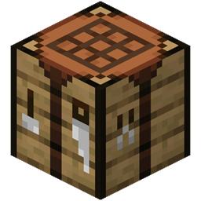

<div align="center">



# CraftingTable · 工作台

**Bring media, ideas and notes together on one canvas.**

[](https://github.com/Blankke/craftingtable/releases/tag/v0.1)
[](#download)
[](#download)
[](https://www.electronjs.org/)
[](#your-project-files)

[中文](README.md) | **English**

[Download](https://github.com/Blankke/craftingtable/releases/tag/v0.1) · [Features](#features) · [Getting started](#getting-started) · [Build from source](#build-from-source) · [Feedback](https://github.com/Blankke/craftingtable/issues)

</div>

CraftingTable is a desktop workspace for planning videos, podcasts, interviews and visual research. Arrange audio, video, images and text on a canvas, connect notes to moments in a recording, and develop longer writing in the integrated notebook.

Projects live in folders you control. Editing, media analysis and saving work locally, with FFmpeg and ffprobe included in the desktop packages.

## Features

| Capability | What you can do |
| --- | --- |
| A canvas for media | Drag in audio, video, images and text; arrange materials alongside shapes, arrows and freehand strokes. |
| Time-based planning | Inspect waveforms and video frames, trim the visible source range, change timeline scale, add time markers and connect them to annotations. |
| A connected notebook | Write with headings, lists, tasks, tables, images and links; use Markdown preview, formulas, code highlighting, split view and Markdown export. |
| Reading and annotation | Annotate selections across paragraphs, follow references back to the source, search and replace, and keep several notes open. |
| Precise composition | Use 43 shapes, alignment, distribution, grouping, rotation and appearance controls. Standard proportion locks preserve circles, squares and regular polygon geometry. |
| Predictable editing | Preview gestures before committing, cancel with Esc, and undo continuous numeric adjustments in one step. Unrelated edits keep media previews stable. |
| A workspace that fits | Resize and collapse panels, switch between canvas and notes, and choose light/dark themes and a Chinese or English interface. |
| Local project storage | Keep original assets with the project, save automatically, and recover the last valid document snapshot. |

## Download

Download the appropriate package from **[GitHub Releases](https://github.com/Blankke/craftingtable/releases/tag/v0.1)**.

| System | Package | Use |
| --- | --- | --- |
| Windows 10 / 11, x64 | `CraftingTable-0.1.0-win-x64.exe` | Installer with a selectable installation folder. |
| Windows 10 / 11, x64 | `CraftingTable-0.1.0-win-x64-portable.exe` | Run without installation. |
| Linux, x64 | `CraftingTable-0.1.0-linux-x86_64.AppImage` | Portable package for desktop distributions. |
| Debian / Ubuntu / Linux Mint, x64 | `CraftingTable-0.1.0-linux-amd64.deb` | Install with the system package manager. |
| Fedora, x64 | `CraftingTable-0.1.0-linux-x86_64.rpm` | RPM package. |

Linux packages target modern glibc desktop systems. Ubuntu 22.04/24.04, Debian 12 and Linux Mint 21/22 are the intended baseline families; see the release notes for the actual validation environment. This release provides x64 packages. ARM64 and Alpine/musl require separate builds.

```bash
# AppImage: mark executable, then launch as a regular desktop user.
chmod +x CraftingTable-0.1.0-linux-x86_64.AppImage
./CraftingTable-0.1.0-linux-x86_64.AppImage

# Ubuntu / Debian / Mint
sudo apt install ./CraftingTable-0.1.0-linux-amd64.deb

# Fedora
sudo dnf install ./CraftingTable-0.1.0-linux-x86_64.rpm
```

If FUSE is unavailable, use `./CraftingTable-0.1.0-linux-x86_64.AppImage --appimage-extract-and-run`, or install the native package. Launch the app as your normal desktop user. Downloads include `SHA256SUMS.txt` for integrity checks. Windows packages are unsigned; the operating system may ask you to confirm the publisher.

## Getting started

1. Create a project from the home screen. Change the default project folder in **Settings** if needed.
2. Import media or drag files from your file manager onto the canvas.
3. Select a media track, position the playhead and press **M** to add a marker. Drag from a selected marker’s connection handle to create or connect an annotation.
4. Switch to **Notes** to write an outline, collect references or review a transcript. Double-click a note on the canvas to open it.
5. Edit an object’s appearance and geometry in the **Edit** panel. Enable **Lock standard proportions** for regular shapes.

Drag gestures show a preview and commit on release; right-click or **Esc** cancels. **Ctrl+S** saves, **Ctrl+Z** undoes, and save status appears beside the project name. Panel sizes, favorites and theme choices are stored on your device.

Supported imports include TXT, MD, PNG, JPEG, WebP, GIF, BMP, MP3, WAV, M4A, AAC, OGG, FLAC, MP4, MOV, MKV and WebM. Playback depends on the file’s codec; importing a container does not guarantee that every codec inside it can play.

## Your project files

```text
My project/
├── project.json   # Canvas, notes, markers and relationships
├── assets/        # Copies of source media
├── cache/         # Rebuildable waveforms and thumbnails
└── recovery/      # Recovery snapshots
```

New projects default to `Documents/工作台`. To move or back up a project, copy the whole folder and choose **Open project folder** on the home screen. Image cropping and media trimming preserve the source files. If a source goes missing, use **Relink** in the asset library.

## Build from source

Use **Node.js 22.21+** and npm. Install dependencies separately on Windows and Linux: Electron and several build tools contain platform-specific binaries.

```bash
npm ci
npm run prepare:media
npm run dev
```

On PowerShell, use `npm.cmd` if the execution policy blocks `npm.ps1`. `dev` opens Electron with Vite hot reload. Renderer edits reload automatically; restart the command after editing `electron/`. Development projects use `.runtime/projects/`, with separate application settings from installed builds.

| Command | Purpose |
| --- | --- |
| `npm run build` | Type-check and build the renderer and desktop processes. |
| `npm run test:unit` | Type-check and run unit tests. |
| `npm run smoke` | Exercise the actual desktop app, project files, media and recovery. |
| `npm run verify` | Run unit, tooling and Electron end-to-end checks. |
| `npm run visual:release` | Reproduce media stability, proportion-lock, icon and splash checks at two scales and themes. |
| `npm run dist:win` | Build Windows installer and portable EXE on Windows. |
| `npm run dist:linux` | Build AppImage, DEB and RPM on Linux; requires `binutils` (ar), `rpm`/`rpmbuild` and `xz-utils`. |
| `npm run dist:linux:docker` | Build Linux packages in an isolated Debian container using Docker. |
| `npm run release:checksums` | Generate checksums for the current version’s packages. |
| `npm run clean -- --dry-run` | Preview generated artifacts eligible for cleanup. |

Packages are written to `release/`. Media tool versions, URLs and SHA-256 checksums are pinned in `scripts/build/media-tools.json`. The build verifies downloaded archives and extracted binaries. Use `HTTP_PROXY` and `HTTPS_PROXY` when required by your network. Docker builds accept `CRAFTINGTABLE_NODE_IMAGE`, `CRAFTINGTABLE_DEBIAN_MIRROR` and `CRAFTINGTABLE_BUILD_NETWORK`. Set `ELECTRON_MIRROR` to use a download mirror; official checksums are still verified.

Desktop tests require a real desktop session, or Xvfb on a native Linux CI runner. The Docker build only compiles and packages; run the unpacked application’s `--smoke` check on the host. Screenshots and test artifacts go to `test-results/`.

To validate packaged binaries:

```powershell
# Windows PowerShell
node scripts/test/smoke-desktop.mjs --executable=release/win-unpacked/工作台.exe
# Use a Windows test account without an existing installation
powershell -ExecutionPolicy Bypass -File scripts/test/verify-windows-package.ps1
```

```bash
# Linux desktop
node scripts/test/smoke-desktop.mjs --executable=release/linux-unpacked/craftingtable
```

## Project structure

| Directory | Responsibility |
| --- | --- |
| `src/core/` | Document model, editing commands, geometry and media analysis scheduling. |
| `src/ui/` | Canvas, notes, media, themes and workspace panels. |
| `electron/` | Windows, restricted IPC, project storage and media workers. |
| `scripts/` | Reproducible development, build, test, visual and maintenance entry points. |
| `tests/` | Desktop tests, real media fixtures and tooling checks. |
| `build/`, `vendor/` | Application icons, media resources and third-party notices. |

## Feedback and credits

For bugs, include your OS, app version, reproduction steps and the relevant part of `runtime.log` from the application’s user-data directory. Report issues at [Blankke/craftingtable](https://github.com/Blankke/craftingtable/issues).

Built with Electron, React, Konva, Tiptap, Markdown-it, KaTeX, highlight.js and FFmpeg. Third-party notices are in [vendor/NOTICE.txt](vendor/NOTICE.txt); bundled media tools include their own license and source information. The handwritten splash uses [Indie Flower](src/assets/fonts/OFL.txt).
